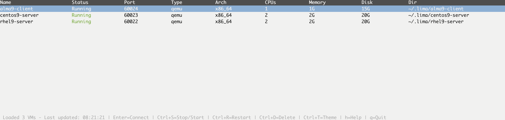
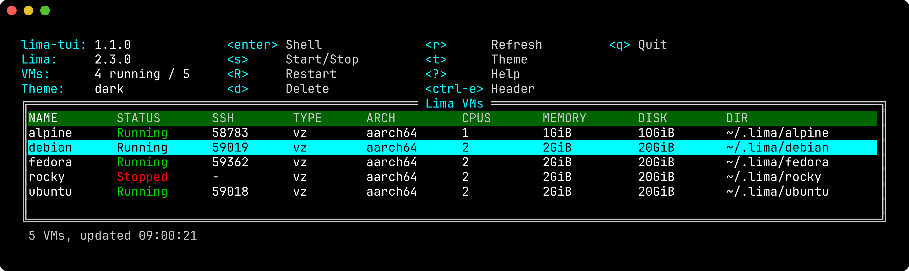

# Lima TUI

A modern Terminal User Interface for managing Lima VMs, inspired by k9s.

Essentially a TUI created in Go with the tview framework. The idea was to improve the built in `limactl list` command 
with features such as:

- Real-time VM overview
- Intuitive controls for navigation
- VM controls, start/stop/restart
- Connecting to VMs 

## Installation

Requires [Lima](https://lima-vm.io/) installed, with `limactl` on your `PATH`.

### Homebrew (macOS)
```bash
brew install davidusken/tap/lima-tui
```

### Go
```bash
go install github.com/davidusken/lima-tui@latest
```

### Prebuilt binaries
Download the archive for your platform (macOS/Linux, amd64/arm64) from the
[releases page](https://github.com/davidusken/lima-tui/releases), extract it and
put `lima-tui` somewhere on your `PATH`.

### Build from source
```bash
git clone https://github.com/davidusken/lima-tui.git
cd lima-tui
make build     # or: go build .
```

## Usage

```bash
lima-tui            # start the TUI
lima-tui --version  # print version
```

## Controls

### Navigation
- `↑`/`k` - Move selection up
- `↓`/`j` - Move selection down

### VM Operations
- `Enter`/`Space` - Toggle VM (start if stopped, stop if running)
- `s` - Start selected VM
- `t` - Stop selected VM  
- `r` - Restart selected VM
- `d` - Delete selected VM
- `c` - Connect to VM via SSH

### Management
- `n` - Create new VM (opens external script)
- `R` - Force refresh VM list
- `h`/`?` - Toggle help screen
- `q`/`Ctrl+C` - Quit

## Interface

The default theme is the dark theme.

### Light 



### Dark



## Development

### File Structure
```
lima-tui/
├── main.go          # Application entry point
├── app.go           # Core application logic
├── ui.go            # User interface components
├── actions.go       # VM operations and actions
├── vm.go            # VM data structures and utilities
├── theme.go         # UI theming and styling
├── go.mod           # Go module definition
├── go.sum           # Dependency versions (auto-generated)
├── Makefile         # Build shortcuts
├── .goreleaser.yaml # Release builds + Homebrew cask
└── README.md        # This file
```

### Dependencies
- [tview](https://github.com/rivo/tview) – Rich TUI framework
- [tcell](https://github.com/gdamore/tcell) - Terminal cell-based display

## Troubleshooting

### VMs not showing up
- Ensure `limactl list` works in your terminal
- Check that Lima is properly installed
- Verify VM permissions

### Build issues
- Ensure Go 1.26+ is installed: `go version`
- Run `go mod tidy` to fix dependencies
- Check network access for Go modules

## Contributing

Pull requests are welcome! See [CONTRIBUTING.md](CONTRIBUTING.md).

## Releasing

Push a tag like `v1.1.0`. The `release` workflow runs GoReleaser, which builds
the binaries, publishes a GitHub release and updates the Homebrew tap.
Run `make snapshot` to try the release build locally without publishing.

## License

[MIT](LICENSE)
