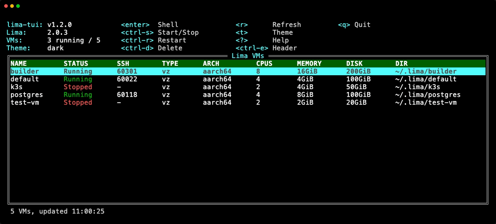
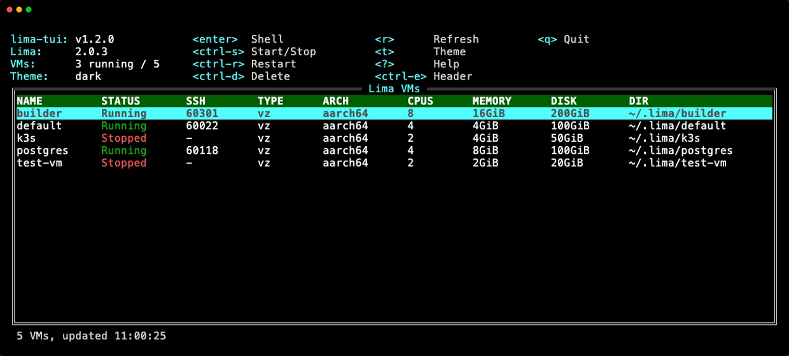
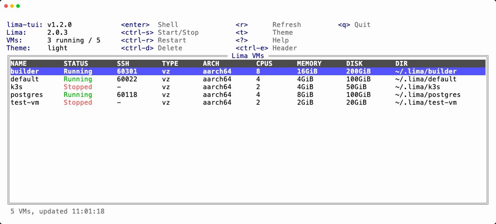

# lima-tui

[](https://github.com/davidusken/lima-tui/actions/workflows/ci.yml)
[](https://github.com/davidusken/lima-tui/releases/latest)
[](https://goreportcard.com/report/github.com/davidusken/lima-tui)
[](https://opensource.org/licenses/MIT)

A terminal UI for [Lima](https://lima-vm.io/) VMs, in the spirit of k9s.
See all your instances at a glance, start, stop, restart or delete them, and jump
into a shell, without typing `limactl` commands.

<picture>
  <source media="(prefers-color-scheme: dark)" srcset="assets/demo-dark.gif">
  <source media="(prefers-color-scheme: light)" srcset="assets/demo-light.gif">
  
</picture>

## Features

- Live list of all Lima instances, refreshed every few seconds
- Start/stop, restart and delete (with confirmation) from the keyboard
- Open a shell in a VM and come back to the list when you exit
- Errors from `limactl` shown in the status bar
- Light and dark themes, plus your own colour skins

## Installation

Requires [Lima](https://lima-vm.io/docs/installation/) 1.1 or newer, with `limactl` on your `PATH`.

**Homebrew** (macOS)

```bash
brew install davidusken/tap/lima-tui
```

**Go** (1.26+)

```bash
go install github.com/davidusken/lima-tui@latest
```

**Prebuilt binaries** for macOS and Linux (amd64/arm64) are on the
[releases page](https://github.com/davidusken/lima-tui/releases/latest).

## Usage

```bash
lima-tui
```

| Key | Action |
|---|---|
| `↑`/`↓`, `j`/`k` | Select VM |
| `g` / `G` | First / last VM |
| `Enter`, `c` | Open a shell in the VM (`limactl shell`) |
| `Ctrl+S` | Start or stop the VM |
| `Ctrl+R` | Restart the VM (`limactl restart`) |
| `Ctrl+D` | Delete the VM (asks first; a running VM is shut down) |
| `r` | Refresh now |
| `t` | Next theme/skin |
| `?`, `h` | Toggle the key help panel |
| `Esc` | Close the help panel |
| `Ctrl+E` | Hide/show the header with key hints |
| `q`, `Ctrl+C` | Quit (asks first while a start/stop/delete is still running) |

Actions that change a VM need Ctrl, so a stray key press can't stop one.

`lima-tui --version` prints the installed version.

## Themes and skins

lima-tui has two built-in themes, `dark` (the default) and `light`:

| `dark` | `light` |
|---|---|
|  |  |

You can add your own as YAML skins, much like k9s skins:

1. Put a skin file in `~/.config/lima-tui/skins/<name>.yaml`
   (or `$XDG_CONFIG_HOME/lima-tui/skins/` if you set `XDG_CONFIG_HOME`).
2. Start with it: `lima-tui --skin <name>`, or make it the default in
   `~/.config/lima-tui/config.yaml`:

   ```yaml
   skin: solarized-dark
   ```

   `--skin` wins over the config file. It also takes a path to a skin file
   (`lima-tui --skin ./my-skin.yaml`), handy while you're editing one. A bare
   file name that isn't in the current directory is looked up in the skins folder.
   In `config.yaml`, relative paths are relative to the config folder
   (`foo.yaml` means `skins/foo.yaml`), and `~/` works.

Press `t` to cycle through the built-ins and every skin in the skins folder.

Ready-made skins are in [`skins/`](skins/): `transparent` (keeps your
terminal's own background and colours), `solarized-dark` and `gruvbox-light`.

A skin sets any of these keys; anything left out keeps the dark theme's colour:

```yaml
bg: default          # background
fg: "#c0caf5"        # normal text
dim: gray            # borders, status bar, secondary text
title: aqua          # panel titles
header:   { fg: white, bg: darkgreen }   # table header row
selected: { fg: black, bg: aqua }        # selected row
button:   { fg: white, bg: darkblue }    # delete dialog buttons
status:
  running: green
  stopped: red
  starting: yellow     # also used while restarting
  stopping: orange     # also used while deleting
```

Colours are W3C names (`aqua`, `darkslategray`, …), `"#rrggbb"`, or `default`
for the terminal's own colour (`bg: default` gives a transparent background).
`"-"` also means default, but has to be quoted. Quote hex values too, since `#`
starts a YAML comment. Unknown keys or colours are reported at startup.

## Troubleshooting

- **"limactl not found"**: install Lima, or make sure `limactl` is on the `PATH` of the shell you start lima-tui from.
- **No VMs listed**: check that `limactl list` shows them. lima-tui reads the same list.
- **An action fails**: the status bar shows the error from `limactl`. Run the same command by hand (e.g. `limactl start myvm`) for the full log.

## Contributing

Issues and pull requests are welcome. See [CONTRIBUTING.md](CONTRIBUTING.md).

## License

[MIT](LICENSE)
